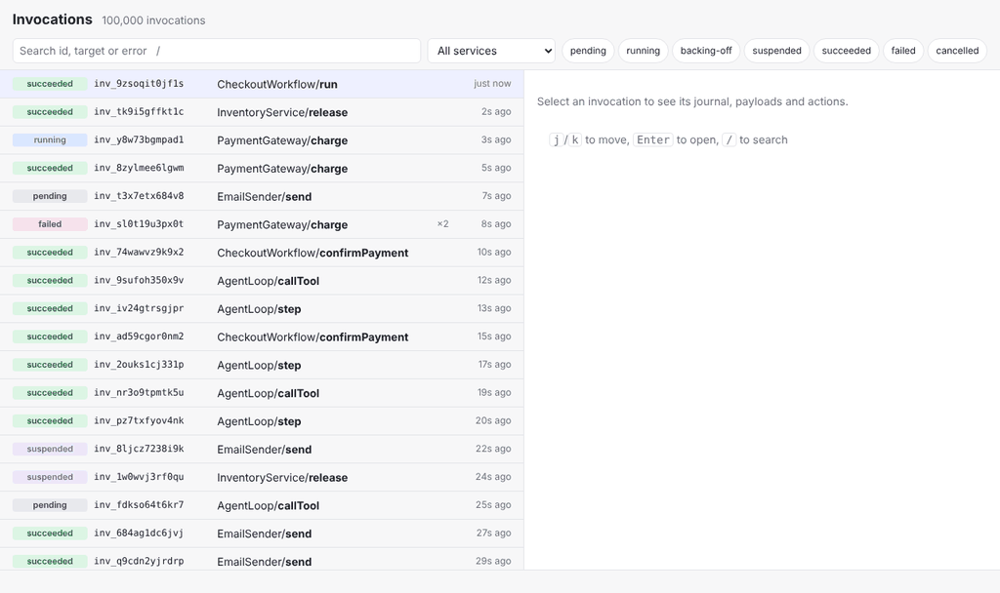
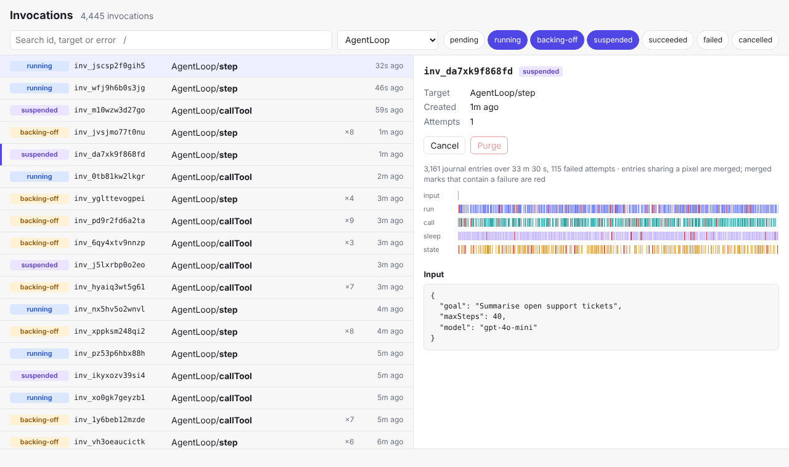

# invocation-explorer

An operator UI for a durable execution runtime. When something is stuck, retrying or has already failed, this is where you look: a live list of invocations that keeps changing while you read it, an execution timeline for each one, the payloads that went in and out, and the controls to cancel or purge.



It runs against an in-memory runtime (`src/runtime/FakeRuntime.ts`) that behaves like the real thing. It holds 100,000 invocations, new ones keep arriving, active ones retry, suspend and complete every second, requests take time and occasionally fail. The UI only talks to the `InvocationsApi` interface, so pointing it at a real admin API means writing one adapter.

## What it does, and how

**Data bigger than the viewport.** The list is virtualized: whether there are 300 invocations or 100,000, the DOM holds about 30–40 rows. It loads only the pages around the viewport, 100 rows at a time, and only those pages are polled. Measured in headless Chromium at 1440×900 with 100,000 invocations: 31–39 rows and under 320 DOM nodes at the top, middle and bottom of the list. Scrolling 900 px per frame for 200 frames gave 16.6 ms p50 and 19.4 ms p95 frame times.

**Data that changes under you.** Every list request carries the filter it was made for and a sequence number. A response for a filter you've already left, or an older poll of the same page that arrives after a newer one, is dropped (`src/data/listState.ts`). Switching the selected invocation aborts the previous request, so a slow response can't replace what you're now looking at. Completed invocations stop polling.

**Timelines that stay honest at scale.** An agent step can have thousands of journal entries, more than there are pixels. Entries that land in the same pixel column of a lane are merged into one mark (`src/ui/timeline.ts`). Every entry is still counted, and a merged mark containing a failed attempt is drawn red, so aggregation never hides a failure. Tests check this with 10,000 entries and a single failure.



**Untrusted content.** Payloads come from users' own services. They are rendered as text, never as HTML. Only `http:` and `https:` URLs become links, with `rel="noopener noreferrer nofollow"`. Long payloads are truncated until you ask for the rest. The demo runtime deliberately includes payloads such as `` and `javascript:` URLs. Unit and end-to-end tests check that nothing executes and no link is created.

**Destructive actions.** Cancel and purge stop or delete real work, so both ask first:

- The dialog focuses the safe choice, keeps Tab inside, closes on Escape and returns focus to the button that opened it.
- A cancel shows up immediately and is rolled back if the server refuses it, for example because the invocation completed in the meantime. A confirmed change stays on screen until the list has caught up with data at least as new (`src/data/overrides.ts`).
- Purge is only enabled for completed invocations.

**State that survives a refresh.** The filter and the selected invocation live in the URL. Reloading, sharing a link or pressing back lands on the same view. URL values are treated as input: unknown statuses and malformed ids are dropped.

**Keyboard and screen readers.**

- `/` jumps to search, and Enter takes you back to the list.
- `j`/`k` or the arrow keys move through the list, Page Up/Down and Home/End jump, and Enter opens an invocation.
- The list is a listbox with `aria-activedescendant`, `aria-setsize` and `aria-posinset`. Assistive technology knows where you are in 100,000 rows, even though only a few dozen exist in the DOM.

## Tech stack

React 19, TypeScript (strict, `noUncheckedIndexedAccess`), Vite, Vitest, Testing Library, Playwright. There is no UI or data-fetching library: the virtualization, paging, polling and stale-response handling are small enough to own and test directly.

## Running it

```bash
npm ci
npm run dev                  # http://localhost:5173
```

The demo runtime can be tuned with environment variables:

| Variable | Default | |
| --- | --- | --- |
| `VITE_INVOCATIONS` | `100000` | Invocations to generate |
| `VITE_LATENCY_MS` | `120` | Simulated request latency |
| `VITE_FAILURE_RATE` | `0.02` | Share of requests that fail, to exercise error handling |

## Tests

```bash
npm run typecheck
npm test             # 54 unit and component tests
npm run e2e          # builds the app, runs the browser tests on desktop and mobile viewports
```

If Playwright's own browser isn't installed, set `PLAYWRIGHT_CHROMIUM_PATH` to a local Chromium.

## Layout

```
src/domain/     invocation model, filters, URL state, the InvocationsApi port
src/runtime/    in-memory runtime used by the demo and the tests
src/data/       paged list state, polling hooks, optimistic overrides
src/ui/         virtual list, timeline, payload view, dialog, toolbar
e2e/            Playwright tests
```

## License

MIT
